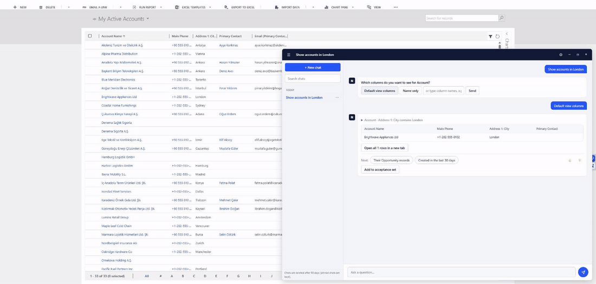
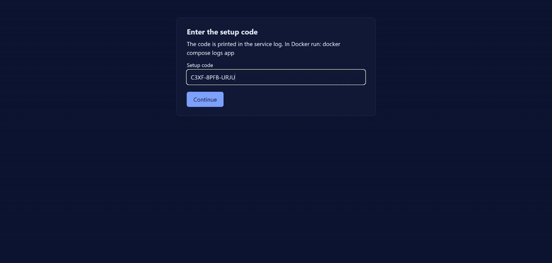
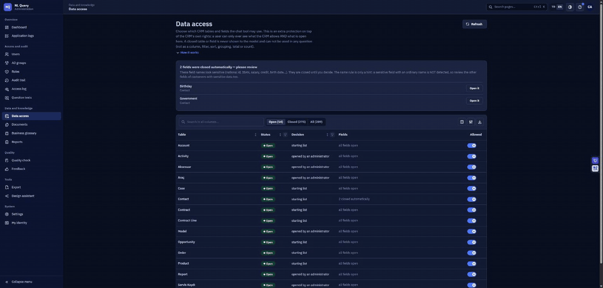
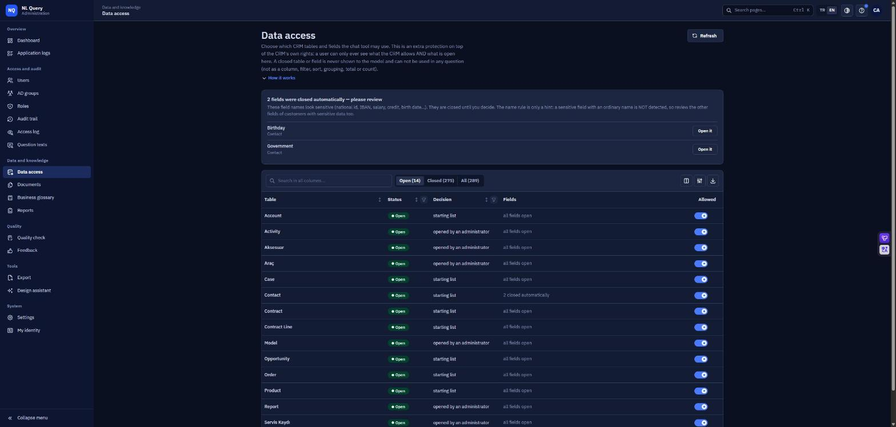
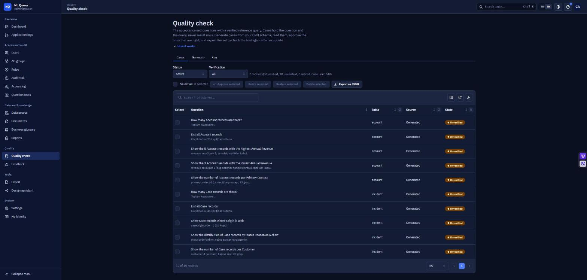
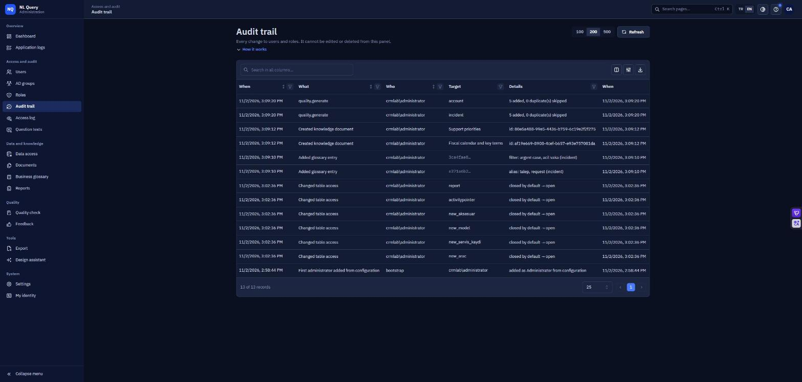
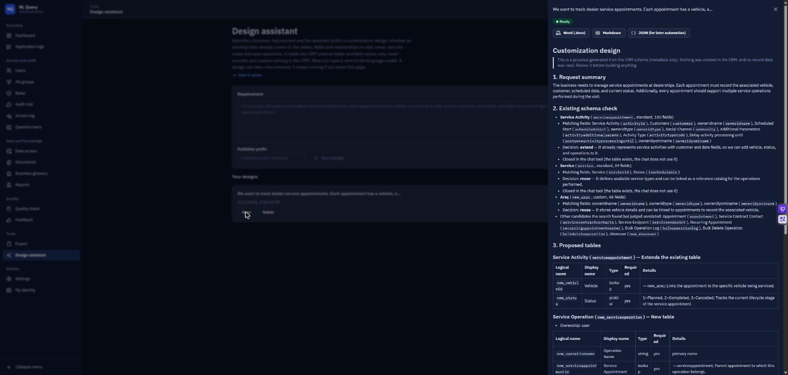

<h1 align="center">CrmNlQuery</h1>

<p align="center">
  <b>Ask your on-premises Dynamics 365 questions in plain language.<br>Your data never leaves your network.</b>
</p>

<p align="center">
  <a href="https://github.com/furkanpasaoglu/CrmNlQuery/actions/workflows/ci.yml"></a>
  
  
  
  
  
</p>

<p align="center">
  <a href="README.tr.md">Türkçe</a> ·
  <a href="docs/screenshots.md">Screenshots</a> ·
  <a href="docs/deployment.md">Deploy</a> ·
  <a href="docs/architecture.md">Architecture</a> ·
  <a href="docs/specs/README.md">Design specs</a> ·
  <a href="docs/features.md">Features</a>
</p>

<p align="center">
  
</p>

---

## What it does

CrmNlQuery adds a chat window to your Dynamics 365 (on-premises) pages. An analyst types a question; a **local** language model turns it into a validated, read-only FetchXML query; the query runs **as that user**, so the CRM's own security still decides what they can see. The answer comes back as a table, a chart or a summary.

| You ask | You get |
|---|---|
| `Show accounts in London` | a table, with the plain-language explanation of every filter |
| `Show the number of cases by priority as a chart` | a chart with a table view and PNG download |
| `Summarize Brightwave Appliances Ltd` | a customer summary built by code from fixed queries |
| `Show the open opportunities of this customer` | the answer for the record open on the form |
| `Show urgent cases` | your company's own term, applied and checked by code |
| `İstanbul'daki hesapları getir` | the same, in Turkish |
| `Write a short follow-up e-mail to Freya Testwell` | a draft whose values are filled by code (nothing is ever sent) |
| `open the Neglected Cases report` | a button that opens the CRM report |

## Why it exists

Many companies still run Dynamics 365 on-premises because their data may not leave the building. Cloud copilots are not an option for them, and report building stays with a few specialists.

|  |  |
|---|---|
| 🏠 **Local models** | Ollama or vLLM on your own hardware. A cloud model is possible, but disabled unless you explicitly allow it, and meant for non-sensitive data only. |
| 🙈 **The model never sees row data** | It sees the question and the schema. Records are read by code, as the signed-in user. |
| 🧑‍⚖️ **Human in the loop** | Anything that writes to the CRM is previewed and needs an explicit click. The service account is read-only by design. |
| 🔎 **Auditable** | Every read is logged (who, which tables, how many rows) without storing the data itself. |

## Highlights

- **Natural language to FetchXML** for Turkish and English, with a plan validator that rejects anything outside an allow-list before it reaches the CRM
- **Multi-step questions:** conditions ("if there are none, ...") and dependent steps ("the contacts of the account with the most open opportunities")
- **Follow-ups and context:** "only the ones in Istanbul", "this account's contacts"
- **Explainable:** every answer says what it filtered on, and filters can be removed or changed without calling the model again
- **Customer summary, charts, e-mail drafts, report finder, business glossary, knowledge base (RAG)**
- **Chat window in CRM pages** with conversations, stop button, slash commands, feedback and light/dark themes
- **React administration panel:** users and roles, data access policy, audit trail, quality checks, settings, export
- **Evaluation framework** that compares answers with reference queries on live data

The full list is in [docs/features.md](docs/features.md).

## How it works

```
 CRM page                        CrmNlQuery service                           Dynamics 365
┌──────────────┐   question    ┌─────────────────────────────────────┐
│ chat window  │ ────────────► │ analyze ─► resolve names ─► plan    │
│ (shadow DOM) │               │  (model)    (CRM read)     (model)  │
│              │               │              │                      │
│              │  table/chart  │       validate (code, allow-lists)  │  FetchXML, as the user
│              │ ◄──────────── │              ▼                      │ ───────────────────────►
└──────────────┘               │     execute ─► build table / chart  │ ◄───────────────────────
                               └─────────────────────────────────────┘     rows (never to the model)
```

## Built with

| Area | Technologies |
|---|---|
| Service | C# / .NET 10, ASP.NET Core (minimal APIs), Npgsql, Serilog |
| Data | PostgreSQL 17 with pgvector, AES-GCM encrypted settings |
| AI | Ollama (default), vLLM (OpenAI-compatible), optional Claude API, bge-m3 embeddings, JSON-schema structured output |
| CRM | Dynamics 365 Web API (OData), FetchXML, impersonation, Windows (NTLM) authentication |
| Chat window | Vanilla JavaScript, Shadow DOM, Canvas charts (no libraries) |
| Admin panel | React 19, TypeScript, Vite, Mantine 9, TanStack Query, React Router, Recharts |
| Quality | xUnit (about 2,900 tests), architecture and contract tests, Node checks, GitHub Actions |
| Delivery | Docker, Docker Compose, PowerShell setup scripts |

## AI concepts at a glance

| Concept | How it is used | Design spec |
|---|---|---|
| **RAG** | bge-m3 embeddings in pgvector, hybrid search (vector + full text, merged with reciprocal rank fusion), chunking and a similarity threshold; only relevant pieces reach the prompt | [knowledge base](docs/specs/knowledge-base.md) |
| **Human in the loop** | Record creation needs a preview and an explicit click; e-mail drafts are never sent; the quality set grows only with an administrator's approval | [record creation](docs/specs/record-creation.md), [e-mail draft](docs/specs/email-draft.md), [quality checks](docs/specs/quality-checks.md) |
| **Guardrails** | Plan validator, allow-lists, a data access policy, quotas, an emergency stop and a daily cloud token budget | [guardrails](docs/specs/guardrails-and-limits.md), [data access policy](docs/specs/data-access-policy.md) |
| **Prompt-injection defense** | Text that comes from the CRM is flattened, stripped of hidden characters and quoted as data; model output is verified by code | [guardrails](docs/specs/guardrails-and-limits.md) |
| **Structured output** | A JSON schema is enforced on every model call (Ollama `format`, vLLM `response_format`, Claude structured output) | [natural-language query](docs/specs/natural-language-query.md) |
| **Text-to-query** | A three-step workflow: analyze, decompose, plan; conditional and dependent multi-step plans | [natural-language query](docs/specs/natural-language-query.md), [conditional plans](docs/specs/conditional-plans.md), [dependent steps](docs/specs/dependent-steps.md) |
| **Semantic layer** | A business glossary turns company terms into filters that code enforces | [business glossary](docs/specs/business-glossary.md) |
| **Context engineering** | Rule-based context pruning, examples drawn from the question's own tables, prompt-size metering | [prompt structure](docs/specs/prompt-structure.md), [context window](docs/specs/prompt-size-and-context-window.md) |
| **Prefix-cache friendly prompts** | Stable parts first, changing parts last, so the model server can reuse its cache; plus our own plan and analysis caches | [prompt structure](docs/specs/prompt-structure.md) |
| **Evals** | Reference-query mode (the expected result is computed on live data), an acceptance set generated from the schema, regression reports, scheduled runs, load and latency measurement | [reference queries](docs/specs/reference-query-evaluation.md), [quality checks](docs/specs/quality-checks.md), [starter set](docs/specs/starter-acceptance-set.md) |
| **Local, model-agnostic inference** | Ollama, vLLM and an optional cloud model behind one interface; per-step settings for thinking, context size and keep-alive | [vLLM provider](docs/specs/vllm-provider.md) |
| **Privacy by design** | The model never sees row data; every read is logged without the data itself | [data access log](docs/specs/data-access-log.md), [data access policy](docs/specs/data-access-policy.md) |

**Deliberately not used:** autonomous agents and function calling (the pipeline is deterministic: the model proposes, code decides), fine-tuning, and LLM-as-judge (answers are checked against reference queries instead).

## Security model

| Principle | How |
|---|---|
| Users are identified by the CRM | The chat window creates a one-time task as the signed-in user; the service reads who created it. No second password, no matter how the CRM signs people in. |
| Every read runs as the caller | CRM impersonation; an empty identity never falls back to the service account. |
| Least-privileged service account | Read access to an allow-listed set of tables; its own calls go through an allow-listed read policy. |
| A second gate on top of the CRM | Administrators choose which tables and fields may be asked about; sensitive-looking fields start closed. |
| Quotas and an emergency stop | Per-user limits, concurrency, end-to-end timeout, one switch to pause asking. |
| Strict web hygiene | No inline scripts (CSP), cross-site request guard, size limits. |

## Quick start

Requirements: Docker with Compose, a Dynamics 365 on-premises organization (Web API enabled), a least-privileged CRM service account, and Ollama (or another supported model server).

```bash
cp .env.example .env          # set POSTGRES_PASSWORD to a long random value; leave CRM_PASSWORD empty
docker compose up -d --build
docker compose logs app       # prints the one-time setup code
```

Open `http://localhost:5080/setup`, enter the code and follow the wizard. It tests the CRM connection and the model before anything is saved, and stores secrets encrypted. Then add the chat window to the CRM with `tools/Install-ChatWidget.ps1`. The full guide, including the CRM service account, is in [docs/deployment.md](docs/deployment.md).

<p align="center">
  
</p>

## Administration panel

<p align="center">
  
</p>

<table>
  <tr>
    <td width="50%"><br><sub><b>Data access.</b> Choose which tables and fields the tool may use, on top of CRM security.</sub></td>
    <td width="50%"><br><sub><b>Quality check.</b> An acceptance set generated from your schema.</sub></td>
  </tr>
  <tr>
    <td width="50%"><br><sub><b>Audit trail.</b> Every change to users, roles and settings.</sub></td>
    <td width="50%"><br><sub><b>Design assistant.</b> A written customization design; it creates nothing in the CRM.</sub></td>
  </tr>
</table>

More screenshots: [docs/screenshots.md](docs/screenshots.md).

## Documentation

| | |
|---|---|
| [docs/deployment.md](docs/deployment.md) | Docker deployment, the setup wizard, the CRM service account |
| [docs/architecture.md](docs/architecture.md) | Layers, dependency rules, request flow |
| [docs/specs/](docs/specs/README.md) | One design spec per feature |
| [docs/features.md](docs/features.md) | What the product does |
| [eval/README.md](eval/README.md) | The evaluation packs |
| [tools/README.md](tools/README.md) | Setup and measurement scripts |

## Repository layout

| Path | Content |
|---|---|
| `src/` | The service: `Domain`, `Application`, `Infrastructure`, `Composition`, `Web` (HTTP and the chat widget), `Eval` (evaluation runner) |
| `admin-ui/` | Administration panel |
| `tests/` | Unit, contract and architecture tests, plus widget and catalog checks |
| `eval/` | Evaluation packs: questions with expected results |
| `tools/` | Setup and evaluation scripts |
| `docs/` | Design specs, architecture, deployment guide, feature list |

## Development

```bash
dotnet test --filter "Category!=Live"            # unit tests; "Live" tests need a CRM or PostgreSQL
for f in tests/widget/*.test.js; do node "$f"; done
cd admin-ui && npm ci && npm run build           # writes src/CrmNlQuery.Web/wwwroot/admin-next
```

The project is developed spec-first: each feature starts as a short design document in `docs/specs`, then a test, then code. Hard-coded user-facing text is not allowed; every message lives in a catalog with English and Turkish side by side, and a test enforces it.

## Status

- Developed and verified against Dynamics 365 (on-premises) 9.0. Version 8.2 is the compatibility target.
- Record creation from chat is implemented but off by default; it needs an extra privilege on the service account.
- Windows (NTLM) authentication is supported from the service to the CRM; AD FS-only endpoints are not supported yet.
- Run a single service instance. See the limits in [docs/deployment.md](docs/deployment.md#9-operational-limits).

## License

[MIT](LICENSE)
