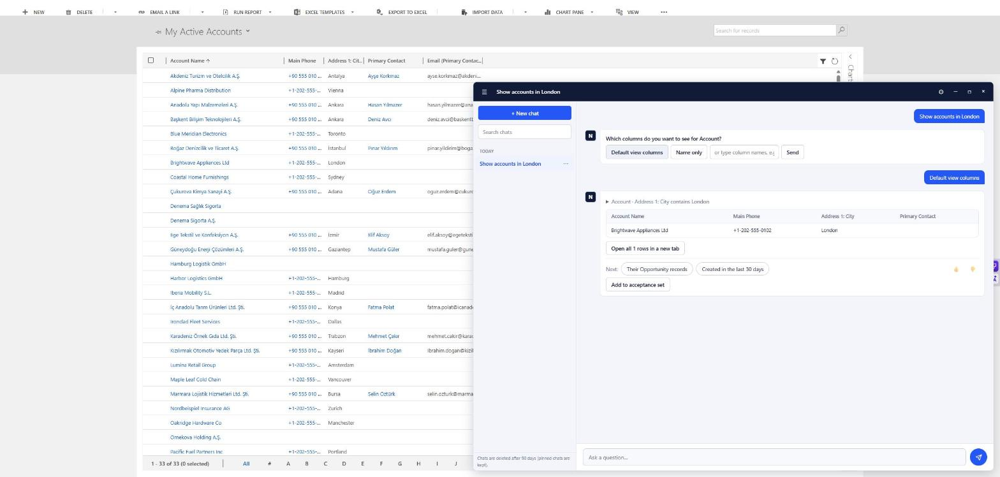

# CrmNlQuery

**Şirket içi (on-premises) Dynamics 365 CRM'inize sade bir dille soru sorun. Verileriniz ağınızdan dışarı çıkmaz.**

[English](README.md)

CrmNlQuery, Dynamics 365 (on-premises) sayfalarına bir sohbet penceresi ekler. İş analisti "İstanbul'daki, 100 binin üzerinde açık fırsatı olan hesapları göster" yazar; yerel bir dil modeli bunu doğrulanmış, salt okur bir FetchXML sorgusuna çevirir ve sorgu **o kullanıcı adına** çalışır. Kullanıcının neyi göreceğine yine CRM'in kendi güvenliği karar verir. Sonuç tablo, grafik ya da özet olarak gelir.



Sohbet penceresi ve yönetim panelinin daha fazla ekran görüntüsü [docs/screenshots.md](docs/screenshots.md) dosyasındadır (İngilizce).

## Neden var

Birçok şirket Dynamics 365'i hâlâ şirket içinde çalıştırıyor, çünkü verisi dışarı çıkamıyor. Bulut tabanlı yardımcılar onlar için seçenek değil, rapor hazırlama da birkaç uzmanda kalıyor. CrmNlQuery bu kurulumlara doğal dille erişim getirir:

- **Yerel modeller.** Kendi donanımınızda Ollama ya da vLLM. Bulut modeli mümkün ama açıkça izin vermedikçe kapalıdır ve yalnızca hassas olmayan veri içindir.
- **Model satır verisini hiç görmez.** Yalnızca soruyu ve şemayı görür. Kayıtları, oturum açmış kullanıcı adına kod okur.
- **İnsan onayı.** CRM'e yazan her işlem önce önizlenir ve açık bir tıklama ister; servis hesabı tasarım gereği salt okurdur.
- **Denetlenebilir.** Her okuma (kim, hangi tablolar, kaç satır) veriyi saklamadan kaydedilir.

## Öne çıkanlar

- Türkçe ve İngilizce sorular için doğal dilden FetchXML'e çeviri
- Çok adımlı sorular: koşullar ("yoksa ...") ve bağımlı adımlar ("en çok açık fırsatı olan hesabın kişileri")
- Devam soruları, form bağlamı ("bu hesabın kişileri"), açıklamalar, sonraki adım önerileri
- Grafik, müşteri özeti, e-posta taslağı, rapor bulma, iş sözlüğü, bilgi tabanı (RAG)
- CRM sayfalarında sohbet penceresi: oturumlar, durdur düğmesi, slash komutları, geri bildirim
- React yönetim paneli: kullanıcı ve roller, veri izin listesi, denetim kaydı, kalite kontrolü, ayarlar, dışa aktarma
- En az yetki ilkesine dayalı güvenlik: CRM kanıtıyla giriş, kullanıcı adına çalışma, izinli okuma listesi, kotalar, satır içi betik yok
- İlk açılışta kurulum sihirbazıyla Docker dağıtımı; sırlar şifreli saklanır
- Cevapları canlı veride referans sorgularla denetleyen bir değerlendirme çerçevesi

Tam liste [`docs/features.md`](docs/features.md) dosyasındadır.

## Nasıl çalışır

```
 CRM sayfası                     CrmNlQuery servisi                           Dynamics 365
┌──────────────┐     soru      ┌─────────────────────────────────────┐
│ sohbet       │ ────────────► │ analiz ─► ad çözme ─► plan          │
│ penceresi    │               │ (model)   (CRM okuma)  (model)      │
│              │               │              │                      │
│              │  tablo/grafik │      doğrulama (kod, izin listeleri)│  FetchXML, kullanıcı adına
│              │ ◄──────────── │              ▼                      │ ───────────────────────►
└──────────────┘               │   çalıştır ─► tablo / grafik üret   │ ◄───────────────────────
                               └─────────────────────────────────────┘     satırlar (modele gitmez)
```

Servis; Domain / Application / Infrastructure / Web katmanlarına ayrılmış bir .NET 10 uygulamasıdır (bağımlılık kuralları testlerle zorlanır, bkz. [`docs/architecture.md`](docs/architecture.md)). Geçmiş, ayarlar, denetim kaydı ve bilgi tabanı pgvector'lü PostgreSQL'de tutulur.

## Hızlı başlangıç

Gerekenler: Compose'lu Docker, Web API'si açık bir Dynamics 365 on-premises organizasyonu, en az yetkili bir CRM servis hesabı ve Ollama (ya da desteklenen başka bir model sunucusu).

```bash
cp .env.example .env          # POSTGRES_PASSWORD'e uzun rastgele bir değer yazın; CRM_PASSWORD boş kalsın
docker compose up -d --build
docker compose logs app       # tek seferlik kurulum kodunu yazar
```

`http://localhost:5080/setup` adresini açın, kodu girin ve sihirbazı izleyin: bir şey kaydedilmeden önce CRM bağlantısını ve modeli dener. Sonra `tools/Install-ChatWidget.ps1` ile sohbet penceresini CRM'e ekleyin. CRM servis hesabı dahil tüm kılavuz [`docs/deployment.md`](docs/deployment.md) dosyasındadır (İngilizce).

## Depo yapısı

| Yol | İçerik |
|---|---|
| `src/` | Servis: `Domain`, `Application`, `Infrastructure`, `Composition`, `Web` (HTTP ve sohbet penceresi), `Eval` (değerlendirme çalıştırıcısı) |
| `admin-ui/` | Yönetim paneli (React, Vite, Mantine) |
| `tests/` | Birim testleri (xUnit), mimari testleri, widget ve katalog denetimleri (Node) |
| `eval/` | Değerlendirme paketleri: beklenen sonuçlu sorular |
| `tools/` | Kurulum ve değerlendirme betikleri (servis hesabı, widget kurulumu, regresyon, yük testi) |
| `docs/` | Tasarım spec'leri, mimari, dağıtım kılavuzu, özellik listesi |

## Geliştirme

```bash
dotnet test --filter "Category!=Live"            # birim testleri; "Live" testleri CRM veya PostgreSQL ister
for f in tests/widget/*.test.js; do node "$f"; done
cd admin-ui && npm ci && npm run build           # yönetim paneli, src/CrmNlQuery.Web/wwwroot/admin-next klasörüne yazılır
```

Proje önce spec ile geliştirilir: her özellik `docs/specs` içinde kısa bir tasarım belgesi olarak başlar, sonra test, sonra kod gelir. Kodda gömülü kullanıcı metni yasaktır; her ileti İngilizce ve Türkçe yan yana bir katalogda durur ve bir test bunu zorlar.

## Durum

- Dynamics 365 (on-premises) 9.0 üzerinde geliştirildi ve doğrulandı. 8.2 uyumluluk hedefidir.
- Sohbetten kayıt oluşturma uygulandı ama varsayılan olarak kapalıdır; servis hesabına ek yetki ister.
- Servisten CRM'e Windows (NTLM) kimlik doğrulaması desteklenir; yalnızca AD FS ile açılan uçlar henüz desteklenmez.
- Tek servis örneği çalıştırın. Sınırlar için [`docs/deployment.md`](docs/deployment.md#9-operational-limits).

## Lisans

[MIT](LICENSE)
